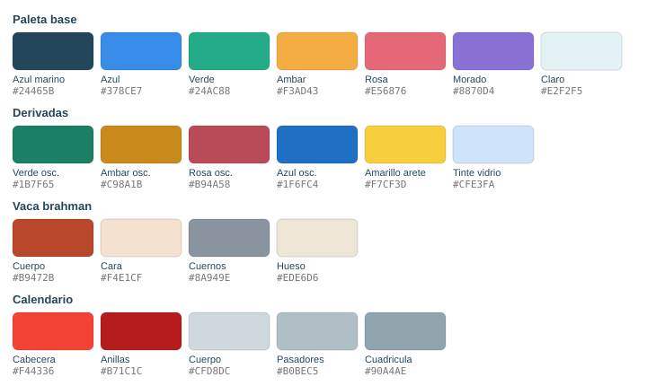

# Paleta de colores del kit de iconos

Guía de colores de `Kit_semantico` (iconos 32×32). La paleta base viene del **kit B**; el resto se
deriva de ella o es una excepción declarada. Los valores salen de `generar_faltantes.py` y
`normalizar_colores.py`: si cambia uno, cambie también el script.

## 0. Objetivo y criterio

El kit debe verse como **un solo sistema** y no como una colección de descargas de orígenes distintos.
No exige que todos los iconos usen exactamente los mismos colores: puede haber colores adicionales
(un verde más oscuro para un trazo, un tinte suave para un relleno) siempre que **no se vean
desubicados**. Un color adicional es aceptable si cumple lo siguiente:

- es de la **misma familia de tono** que un color de la paleta (no un magenta ni un cian nuevos);
- tiene un **brillo y una saturación parecidos** (ni neón ni apagado);
- aparece como **detalle o tinte**, no como el color dominante del icono.

Además del color cuentan el **estilo** (relleno plano, sin degradados ni trazos finos con relleno
tenue), el **peso visual** y el **vocabulario de formas** (bordes redondeados, insignia con aro blanco).

`python auditar_coherencia.py` revisa los dos primeros automáticamente: estilo de línea, degradados
y colores a más de 55 unidades RGB de la paleta aplicable. También marca el terracota como error
y enumera los demás tonos cromáticos sin documentar, incluidos los pasteles. Para detectar variantes
del terracota, usa como aproximación un matiz HSL de 8° a 26°, saturación desde 28 % y luminosidad
del 15 % al 80 %. El castaño y los tintes aprobados del Brahman se reconocen por su valor exacto.
El peso visual y las formas se
revisan a ojo en la vista previa.

## 1. Paleta base



| Rol | Hex | Uso |
|---|---|---|
| Azul marino | `#24465B` | Contornos, ruedas, cuencas, detalles oscuros. Es el hilo que une al kit |
| Azul | `#378CE7` | Acciones de consulta y navegación, flechas, gráficas, engranaje, nube |
| Verde | `#24AC88` | Sumar, confirmar, corral, mapa, gráficas |
| Ámbar | `#F3AD43` | Avisos, camión, etiqueta, carpetas y placas de aretes convencionales y RFID |
| Rosa | `#E56876` | Quitar, cancelar, errores, sanidad (cruz) |
| Morado | `#8870D4` | Jeringa y el punto de "círculo" |
| Claro | `#E2F2F5` | Relleno claro (cara de la jeringa, cuerpos de papel) |

### Variantes derivadas

Solo para trazos o detalles que necesitan más contraste sobre fondo blanco.

| Base | Oscuro | Hex |
|---|---|---|
| Verde | verde oscuro | `#1B7F65` |
| Ámbar | ámbar oscuro | `#C98A1B` |
| Rosa | rosa oscuro | `#B94A58` |
| Azul | azul oscuro | `#1F6FC4` (pliegue de `Enviar`) |

Tinte claro, solo para la cara trasera de `carpeta-abierta` (ámbar al 75 % sobre blanco, como
el original de DevExpress, pero en color sólido para que no se transparente sobre botones pulsados):

| Base | Claro | Hex |
|---|---|---|
| Ámbar | ámbar claro | `#F6C272` |

## 1.1 Jerarquía de color

Tener ocho colores en la paleta no significa que los ocho pesen igual. Cuando varios acentos intensos
(azul, verde, ámbar, rosa, morado) comparten el mismo protagonismo en una barra de herramientas, el
kit se lee más **colorido que corporativo**. La jerarquía fija qué color manda y cuáles apoyan.

| Nivel | Colores | Función | Peso |
|---|---|---|---|
| 1. Identidad | Azul marino `#24465B` y azul `#378CE7` | Definen el tono general del kit. El marino es el ancla (contornos y detalles oscuros); el azul es el cuerpo de las familias de consulta y navegación | Dominante |
| 2. Acciones semánticas | Verde `#24AC88`, rosa `#E56876`, ámbar `#F3AD43` | Confirmar / quitar o cancelar / avisar. Se usan en **insignias y detalles pequeños** (sección 4) | De apoyo |
| 3. Ganado | Terracota `#B9472B` y amarillo arete `#F7CF3D` | Solo donde tienen significado reconocible: terracota en `vaca-*` y `ternero-*`, amarillo en `arete-*` y `arete-rfid-*` | Propio de su familia |
| 4. Reservado | Morado `#8870D4` | Tiempo, historial, marca e identificador (`reloj`, `circulo`). No compite con el color principal | Mínimo |

Reglas para un icono nuevo:

- **Un solo acento intenso** por icono además del marino y los neutros. Hoy es lo habitual (estimación de oct-2026: 244 de 396
  iconos tienen uno; 91 tienen dos; 41 tienen tres o más).
- El **cuerpo** va en marino/azul, o en el color del ganado si el objeto lo es. Un color semántico
  (verde, rosa, ámbar) se reserva para la insignia, no para el cuerpo.
- El **morado** solo en insignias de tiempo o identificador.
- Un color nunca debe significar dos cosas a la vez dentro de la misma familia.

### Estado actual (estimación de oct-2026): dónde el kit se aparta de la jerarquía

Estimación a partir del color dominante de cada SVG, sin contar marino ni insignia. Ningún icono se ha
modificado por esto; es la lista de deuda para decidir caso por caso.

| Desvío | Familias | Decisión pendiente |
|---|---|---|
| Cuerpo en color semántico: verde | `cerca`, `mapa`, `hoja`, `medidor`, `billete`, `carrito` | ¿Pasar a azul o dejar como identidad del objeto (campo, dinero)? |
| Cuerpo en color semántico: ámbar | `camion`, `etiqueta`, `espiga`, `saco`, parte de `corral` | Idem |
| Cuerpo en color semántico: rosa | `cruz`, `implantador` | Choca con rosa = cancelar de la sección 4 |
| Cuerpo en morado | `jeringa`, `matraz` (y lila `#D1C4E9` en `BaseDatos`) | Choca con morado = tiempo; ¿azul o excepción «sanidad»? |
| Tercer rojo | `calendario` `#F44336` | Excepción declarada (sección 3); queda fuera de la jerarquía |

El resultado de cada decisión debe reflejarse en la tabla de la sección 5.

### Contraste: dónde usar cada tono

Contraste contra blanco (WCAG). No indica que un color esté mal, sino dónde puede usarse solo.

| Color | Sobre blanco | Uso |
|---|---|---|
| Marino `#24465B` | 9,99 | Texto, trazos y símbolos pequeños |
| Terracota `#B9472B` | 5,25 | Relleno y trazo |
| Variantes oscuras: verde `#1B7F65`, rosa `#B94A58`, azul `#1F6FC4` | 4,92 · 5,02 · 5,09 | Trazos o símbolos sueltos sobre blanco |
| Morado `#8870D4` | 3,95 | Relleno; trazo solo si es grueso |
| Azul `#378CE7` | 3,46 | Relleno; trazo solo si es grueso |
| Rosa `#E56876` | 3,19 | Relleno con contorno marino |
| Verde `#24AC88` | 2,86 | Relleno con contorno marino; no como trazo suelto |
| Ámbar oscuro `#C98A1B` | 2,94 | No cumple 3:1 todavía (ver sección 10) |
| Ámbar `#F3AD43` | 1,93 | Solo relleno con contorno marino; nunca como trazo ni símbolo sobre blanco |
| Amarillo arete `#F7CF3D` | 1,51 | Solo relleno con contorno marino |

## 2. Vaca brahman (firma propia)

La cabeza de referencia es [vaca.svg](simulador%20de%20control%20ganadero/Kit_semantico/svg/vaca.svg),
variante B aprobada en la prueba de reconocimiento a 32 px. Las orejas se abren hacia los lados y
caen en las puntas. Los cuernos tienen una base ancha junto a la frente y se curvan hacia fuera
y hacia arriba hasta terminar en punta, con espacio visible entre el cuerno y la oreja. La mancha de la frente termina por encima de los ojos para que ambos se lean
sobre la cara crema. Las variantes con insignia reutilizan esta cabeza. La familia `vaca-*` está
excluida de la normalización automática.

| Parte | Hex |
|---|---|
| Pelaje castaño grisáceo (mancha, orejas y hocico) | `#907B6C` |
| Cara | `#F4E1CF` |
| Cuernos | `#8A949E` |
| Hueso (`vaca-calavera`) | `#EDE6D6` |

Los ojos y la nariz son azul marino `#24465B`.

### Cría (ternero)

En `crianza`, la madre usa el castaño grisáceo y el crema de la cabeza brahman.
El pelaje de la cría se aclara mezclando esos dos colores. Ambos animales llevan
ojos y nariz en azul marino `#24465B`.

| Parte | Madre | Cría |
|---|---|---|
| Manchas, orejas y hocico | `#907B6C` | `#B19D8D` |
| Cara | `#F4E1CF` | `#FBF1E6` |
| Interior de las orejas | `#B19D8D` | `#D3BFAE` |

Los iconos `ternero-*` y `ternero` usan los colores de la cría. La pezuña de `huella-luna-cuna`
y el bovino de `documento-vaca` usan el castaño de la madre.

Los tintes `#B19D8D` y `#D3BFAE` mezclan el castaño con un tercio y dos tercios
de crema, respectivamente, en los canales RGB.

## 3. Calendario (excepción)

La base `calendario` es el calendario plano de `flat-color-icons` y **no se normaliza**: su cabecera
roja es parte del icono.

| Parte | Hex |
|---|---|
| Cabecera | `#F44336` |
| Anillas | `#B71C1C` |
| Cuerpo | `#CFD8DC` |
| Pasadores | `#B0BEC5` |
| Cuadrícula | `#90A4AE` |

Sus insignias sí siguen la regla de color por significado (sección 4).

## 4. Insignias: color por significado

Todas las familias con insignia usan el mismo recurso: círculo blanco de radio 6,5 (el aro), círculo de
color de radio 5,5 y símbolo blanco de trazo 1,5, **concéntricos en `(25.5, 25.5)`** de la rejilla de 32
(aro uniforme de 1 px). Antes el aro estaba en `(25, 25)` con radio 7 y quedaba descentrado.

| Color | Significado | Símbolos |
|---|---|---|
| Verde `#24AC88` | Sumar, confirmar, valor | `mas`, `check`, `arriba`, `dolar` |
| Rosa `#E56876` | Quitar, cancelar | `menos`, `x`, `abajo` |
| Ámbar `#F3AD43` | Atención, destacado | `alerta`, `estrella` |
| Azul `#378CE7` | Consultar, navegar | `lupa`, `lista`, `flecha`, `gota`, `documento`, `reporte`, `arribaYabajo` |
| Morado `#8870D4` | Tiempo, historial, marca e identificador | `reloj`, `circulo` |

La regla está en `COLOR_POR_SIMBOLO` de `generar_faltantes.py` y se aplica a las familias listadas en
`COLORES_INSIGNIAS_VACA` (calendario, etiqueta, documento, usuario, barras, comedero, saco,
lápida, matraz, arete-rfid, BaseDatos…). Las insignias de cancelación de vacas y aretes usan rosa.
`GuardarCerrar` lleva una insignia azul para distinguirla del cuerpo verde. La familia `vaca-*` la tiene en su propia tabla (`COLORES_INSIGNIAS_VACA`).

Variante `-reporte`: hoja blanca con línea de tendencia marino, insignia azul. La generan
`generar_reportes.py` (29 familias, sin `documento`, que ya es un reporte) a partir de otra variante de la
misma familia, así que conserva su escala; `generar_faltantes.py` la llama al final.

## 5. Color base de cada familia

| Familia | Color del cuerpo | Insignia |
|---|---|---|
| `vaca-*` | Pelaje brahman `#907B6C` y cara crema `#F4E1CF` | Por significado |
| `calendario-*` | Cabecera `#F44336` | Por significado |
| `etiqueta-*` | Ámbar `#F3AD43` | Por significado |
| `cerca-*` | Azul marino y verde `#24AC88` | Verde |
| `camion-*` | Ámbar `#F3AD43` | Por significado; `camion-descarga` verde (remisión de entrada) |
| `camion-mixer-*` | Cabina `#E2F2F5`, tolva `#E56876` / `#B94A58`, chasis `#24465B` | Por significado; `documento` azul |
| `bascula-camion-*` | Camión ámbar y cabina marino sobre plataforma azul `#378CE7` | Por significado (`lista` azul) |
| `jeringa-*` | Morado `#8870D4` | Morado |
| `indicador-*` | Carcasa `#8A949E`, panel `#24465B`, pantalla `#1F6FC4` | Por significado; descarga azul, carga verde y reloj morado |
| `implantador-*` | Rosa `#E56876`, gatillo marino y aguja gris | Por significado |
| `cruz-*` | Rosa `#E56876` | Rosa |
| `engranaje-*` | Azul `#378CE7` | Azul |
| `nube-*` | Azul claro `#9CC6F2` | Azul |
| `mapa`, `mapa-pin` | Verde `#24AC88` | Verde |
| `arete-*`, `arete-rfid-*` | Placa ámbar `#F3AD43`, contorno marino y ondas azules en RFID | Por significado |
| `documento-*` | Papel `#E2F2F5` con pliegue `#9CC6F2` | Por significado; `-rojo` / `-azul` según el reporte |
| `BaseDatos-*` | Lila `#D1C4E9` (tinte) | Por significado |
| `matraz-*` | Vidrio `#CFE3FA`, líquido morado `#8870D4` | Por significado (`gota` azul) |
| `Guardar`, `GuardarCerrar` | Verde `#24AC88` | Azul en `GuardarCerrar` |
| `Imprimir`, `Enviar` | Azul `#378CE7` | — |
| `comedero-luna`, `comedero-linterna` | Azul `#378CE7`, borde marino y alimento ámbar | Luna o linterna ámbar, integrada en la composición |
| `planilla-luna` | Azul `#378CE7`, papel `#E2F2F5`, marcas verdes | Luna ámbar |
| `arete-rfid-luna` | Amarillo arete `#F7CF3D`, contorno marino y señal azul | Luna ámbar |

`comedero-linterna` usa la versión azul rectangular alargada, ascendente de izquierda a derecha.

Pendiente: las familias con una sola insignia de color (cerca, camión, jeringa, cruz, engranaje,
nube, mapa) todavía no usan el color por significado. Los colores de cuerpo de esta tabla que se
apartan de la jerarquía están listados en la sección 1.1.

## 6. Reglas de normalización

`normalizar_colores.py` lleva cualquier SVG nuevo a la paleta. Clasifica cada color por **tono** y
luego por **luminosidad**:

| Tono | Medio → | Oscuro → |
|---|---|---|
| Rojo | `#E56876` | `#B94A58` (luz < 0,50) |
| Naranja y amarillo | `#F3AD43` | `#C98A1B` (luz < 0,45) |
| Verde y turquesa | `#24AC88` | `#1B7F65` (luz < 0,36) |
| Azul e índigo | `#378CE7` | `#24465B` (luz < 0,33 o tono > 228°) |
| Morado | `#8870D4` | `#8870D4` |

No toca: los colores que ya son de la paleta, los grises y blancos, los **tintes claros**
(luminosidad > 0,72), el magenta y los archivos `calendario*` y `vaca*`.

```bash
python normalizar_colores.py            # simula y muestra el resumen
python normalizar_colores.py --aplicar  # copia de seguridad en Respaldos/ y cambios
```

Los grises y pasteles de Material/Icons8 los remapea aparte `normalizar_material.py` (misma sintaxis,
respaldo en `Respaldos/antes_de_normalizar_material`). Su tabla `MAPA` es la referencia de qué color
de origen va a qué color de la paleta.

## 7. Tintes claros

Rellenos suaves de los iconos de línea. Son aceptados, pero **no forman parte de la paleta**.

`#CFE3FA` azul (vidrio del matraz) · `#D3E2F4` azul · `#F6D9D6` rosa · `#F7E3BE` ámbar · `#D6EBDD` verde · `#D1C4E9` lila · `#9CC6F2` azul de la nube · `#7AD3B8` verde claro de la hoja

## 8. Excepciones y pendientes

| Tema | Estado |
|---|---|
| Hexágono del cargador frontal | Pendiente de decisión visual. El rojo anaranjado `#EE240E` supera la tolerancia de la paleta aplicable al cargador. |
| Fondo de papel de `Importar` | Pendiente de revisión. El rosa claro `#F8BBD0` tiene un matiz más magenta que el tinte documentado `#F6D9D6`. |
| Iconos con **degradado** de Fluent | Resuelto: redibujados planos y sin «Fluent» en el nombre |
| Iconos de **estilo de línea** (`escudo-gris`, `medidor`, `moneda-check`, `prohibido`, `regla`) | Resuelto: redibujados planos |
| Magenta y rosa fuerte `#E91E63` de `Importar` | Resuelto: `Importar` usa `#E56876`; los magentas desaparecieron con los degradados |
| **Colores de Material / Icons8** | Resuelto con `normalizar_material.py`: grises oscuros → marino `#24465B`, grises medios → `#8A949E`, pasteles → tintes de la sección 7 (29 iconos) |
| Grises azulados de Material (`#CFD8DC`, `#90A4AE`, `#B0BEC5`) | Se conservan como neutros (los usa la base `calendario`) |

## 9. Cómo añadir un icono nuevo

1. Usar solo colores de la sección 1 (más los tintes de la 7 si hace falta un relleno suave).
2. Si es una variante con insignia, usar el símbolo y el color de la sección 4.
3. Registrar el icono en `generar_faltantes.py` (`BASES` + `NUEVOS`) para que se regenere con el resto; el nombre es por lo que dibuja (`objeto-accion`), sin el nombre del botón.
4. Pasar `python normalizar_colores.py` para detectar colores fuera de paleta.
5. Regenerar la vista previa: `python generar_vista_previa.py`.

## 10. Propuesta pendiente: contraste del ámbar y de los símbolos de insignia

**Estado: propuesta, sin aplicar.** No se ha modificado ningún SVG ni ningún script.

### Problema

Los símbolos de las insignias son blancos (`#FFFFFF` fijo en `SIMBOLOS` de `generar_faltantes.py`)
sobre el círculo de color, así que valen las mismas cifras de contraste de la sección 1.1:

| Insignia | Símbolo blanco sobre | Contraste | Símbolos |
|---|---|---|---|
| Ámbar `#F3AD43` | `#FFFFFF` | **1,93** | `alerta`, `estrella` |
| Verde `#24AC88` | `#FFFFFF` | **2,86** | `mas`, `check`, `arriba`, `dolar` |
| Rosa `#E56876` | `#FFFFFF` | 3,19 | `menos`, `x`, `abajo` |
| Azul `#378CE7` | `#FFFFFF` | 3,46 | `lupa`, `lista`, `flecha`, `gota` |
| Morado `#8870D4` | `#FFFFFF` | 3,95 | `reloj`, `circulo` |

Además, el **ámbar oscuro** `#C98A1B`, que existe para dar contraste sobre blanco, llega solo a 2,94:1,
por debajo del 3:1 que WCAG pide para gráficos. Las otras tres variantes oscuras superan 4,9.

### Propuesta

1. **Símbolo marino sobre ámbar.** En las insignias ámbar (`alerta`, `estrella`, incluidas
   `vaca-alerta` y `vaca-estrella`) el símbolo pasa de `#FFFFFF` a `#24465B`: contraste **5,17:1**.
   Es coherente con la familia `arete`, que ya combina amarillo con marino. El aro blanco no cambia.
   Implementación: `insignia(simbolo, color)` sustituye `#FFFFFF` por `#24465B` en el símbolo solo
   cuando `color == AMBAR`.
2. **Ámbar oscuro `#C98A1B` → `#B37A19`** (3,67:1 sobre blanco; 3,19:1 sobre `#E2F2F5`). Mismo tono
   (38°) y sigue leyéndose como ámbar. Para texto o un trazo fino, usar `#986816` (4,85:1). Hay que
   cambiarlo en `generar_faltantes.py`, `normalizar_colores.py`, `auditar_coherencia.py`, `paleta.svg`,
   las tablas de este documento y las bases de `Propuetas/` (los corrales se derivan de ellas). Afecta
   a unos 46 iconos del kit y a `familias-corrales.svg`.
3. **Verde: decisión abierta.** El símbolo blanco queda en 2,86:1. Opciones: (a) dejarlo, porque el
   símbolo es grueso y va dentro de un aro blanco; (b) usar `#1B7F65` (4,92:1) como relleno de la
   insignia verde, a costa de cambiar todas las insignias verdes y de acercar el verde al marino.
   Recomendación: (a) por ahora y revisar a tamaño real en la vista previa.
4. **Rosa, azul y morado** ya superan 3:1 con símbolo blanco: no cambian.

### Cómo aplicarlo

```bash
python generar_faltantes.py              # regenera con el símbolo marino sobre ámbar
python normalizar_colores.py --aplicar   # tras actualizar su tabla con #B37A19
python auditar_coherencia.py
python generar_vista_previa.py
```

Antes de aplicar: comparar en `vista_previa.html` los iconos `*-alerta` y `*-estrella` con el símbolo
marino frente al blanco, y confirmar que el ámbar oscuro nuevo no se confunde con el terracota.

## Carnic (excepción)

`carnic.svg` conserva los colores de la referencia aprobada: bovino rojo `#E82126` y tierra verde `#009449`. La familia `carnic*` queda excluida de la normalización de color.
